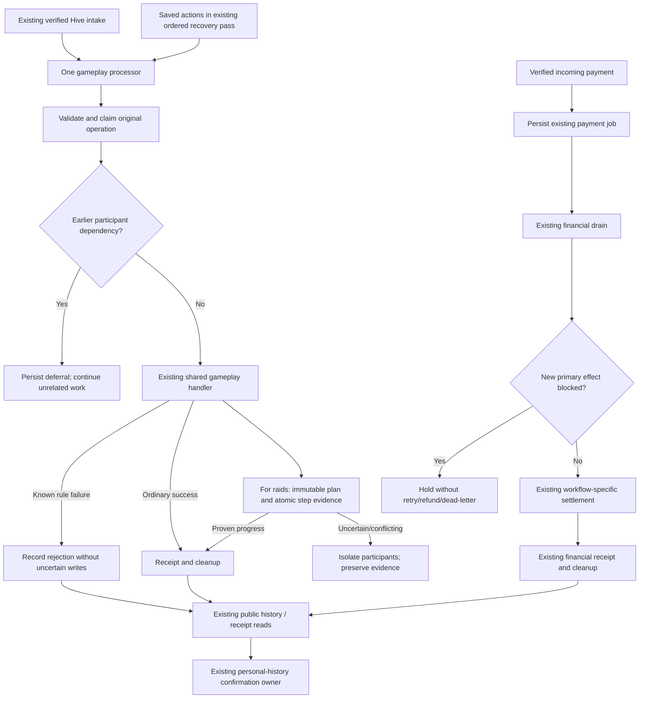

# Smart-contract simplification implementation plan

**Status:** planned, not implemented by this document.  
**Prepared:** 2026-10-21.  
**Scope:** simplify Chainframe's application and worker around a direct, readable processing flow inspired by TerraCore, while retaining Chainframe's mechanics and recovery guarantees.

Implement **one numbered step per working session or prompt**. Finish its verification and handoff before starting the next step. Do not submit this entire document as a request to execute every step at once.

The existing raid isolation/recovery changes are the starting point. This plan is a follow-up simplification, not a request to remove that protection or replay historical raids. [GAME_ARCHITECTURE.md](GAME_ARCHITECTURE.md) and [GAME_MECHANICS.md](GAME_MECHANICS.md) remain the descriptions of implemented behavior. Update them as each implementation step lands; do not describe planned work as already delivered.

## 1. Direction and boundaries

### The design we want

The normal gameplay path should be easy to read from start to finish:

**Observe a verified blockchain operation → validate it → check dependencies → execute its game handler → record the result → continue.**

Keep one worker intake owner, one gameplay processor, one financial drain and the existing browser confirmation owner. Individual game handlers remain distinct owners of their mechanics. Shared scheduling does not require merging financial settlement into gameplay.

TerraCore is useful as a structural reference: a small dispatcher, direct domain handlers and separate financial work. Its reviewed source also stores battles/claims in a database queue and has partial-write/acknowledgment limitations. See [TERRACORE_SMART_CONTRACT.md](TERRACORE_SMART_CONTRACT.md) for the pinned source review. Its long-running operation motivates this review, but uptime/error frequency is not evidence that every recovery shortcut is safe for Chainframe.

### What this update means by simplification

- Fewer overlapping branches and repeated state reads with the same purpose.
- Explicit domain outcomes instead of exception-message interpretation.
- A single visible orchestration path reused by live intake and saved-action recovery.
- Financial settlement rules kept within their existing financial workflow owners.
- Raid calculation/effects kept within the shared raid owner; claims, receipts and scheduling kept within the worker owner.
- Small functions only where they clarify a responsibility. No generic workflow engine, compatibility forwarding layer or second action registry.
- Tests organized around observable guarantees, retaining real database interruption tests.

Do not measure success solely by line count. Moving complexity into generic callbacks or deleting safety evidence would make the system harder to understand. A deletion/consolidation must identify the behavior it preserves and the regression check proving that behavior.

### Fixed constraints for every step

1. Preserve formulas, timing, seeds, rounding, equipment/effect rules, raid rewards/risk/protection and charge-regeneration behavior.
2. Preserve the Hive protocol, payment envelopes, routing evidence and exact persisted treasury intents. Keep `hivexph-sdk` pinned at 1.2.1 with its existing lockfile.
3. Keep seven production collections, existing indexes/routes and standalone MongoDB support. No database transaction/session requirement, new collection, index, migration, backfill or automatic cleanup script.
4. Keep lease ownership, irreversible verification, inclusive in-process replay, latest-irreversible startup and readiness behavior. No automatic catch-up of unseen downtime submissions.
5. Keep the existing worker scheduling cycle. No extra timer, browser poller or blockchain observer.
6. Keep public DTOs/history/receipt contracts and private-field filtering. The existing personal-history poller alone owns authoritative confirmation, refresh and completion feedback.
7. Preserve legacy stuck records, version-1 journals, active raid markers and all unresolved treasury evidence. Do not clear markers, invent receipts, compensate uncertain effects, reset transfers or replay legacy raids.
8. Repositories access only their collection. Shared backend code never imports worker internals, including types. Workers delegate persistence/domain work to their existing feature owners.
9. Keep unregistered profiles out of raid targets before limiting results; reject unregistered direct raid targets server-side before effects.
10. Automated validation never broadcasts real payments or writes the operational application database. MongoDB tests use isolated `chainframe_test_` databases and guarded cleanup only.

### Desired outcome policy

| Situation                                                                | Result / behavior                                                                                |
| ------------------------------------------------------------------------ | ------------------------------------------------------------------------------------------------ |
| Valid action completes and durable terminal result exists                | `executed`; proceed                                                                              |
| Known protocol/rule failure with no uncertain writes                     | `rejected`; durable terminal result; proceed                                                     |
| Earlier participant-dependent work is unresolved                         | `deferred`; save unchanged original input; no effects/completion; proceed for unrelated accounts |
| Raid has conflicting/legacy/unsupported/exhausted uncertain evidence     | `quarantined`; retain evidence and participant holds; unrelated work continues                   |
| Version-1 raid has exact evidence for bounded recovery                   | Resume through normal guarded processor; no reroll or duplicate effects                          |
| Database/lease failure prevents durable classification or safe isolation | Throw; stop advancement and use existing worker recovery                                         |
| Non-raid has uncertain writes under its existing policy                  | Retain its current recovery/parking behavior; do not grant raid-specific skip privileges         |

Known validation errors and unknown write outcomes are different. Catching every exception and returning `rejected` is not part of this plan. Neither deleting all pending gameplay documents nor eliminating durable receipts is a default objective.

## 2. Target flow and ownership



The diagram shows responsibilities, not a proposal to introduce a module for every box. Claim/validation order may be retained where needed to preserve durable failure and replay behavior; Step 1 must document those dependencies before rearranging code.

| Existing owner                                            | Role to retain                                                        |
| --------------------------------------------------------- | --------------------------------------------------------------------- |
| `server/game-smart-contract/index.ts`                     | Startup/configuration, lifecycle and automatic recovery coordination  |
| `server/game-smart-contract/workers/`                     | Iteration, timer ownership, backoff, cancellation and shutdown        |
| `.../features/events/process-game-action/action.ts`       | One gameplay orchestration path and safe outcome classification       |
| `.../process-game-action/validation.ts`                   | Protocol validation and `GameActionRejectedError`                     |
| `.../process-game-action/dispatch.ts`                     | Existing action-to-handler registry/dispatch                          |
| `.../process-game-action/persistence.ts`                  | Claims, receipts and pending cleanup coordination                     |
| `.../process-game-action/recovery.ts`                     | Startup/scheduled recovery and supported internal inspect/resume      |
| `features/events/backend/`                                | Shared domain workflows; preserve existing flat owner structure       |
| `features/events/backend/raid/action.ts`                  | Raid planning, evidence validation and application of game effects    |
| `features/events/backend/raid/dependencies.ts`            | Existing participant/dependency coordination, including payment holds |
| `features/types/game/raid-settlement.ts`                  | Shared private raid evidence contracts; no worker imports             |
| `.../features/events/payment-processing/` and `treasury/` | Workflow-specific financial settlement/reconciliation                 |
| `lib/modules/`                                            | Seven collection repositories and atomic persistence primitives       |
| `lib/utils/database/operation.server.ts`                  | Existing ordered write scope and uncertainty tracking                 |
| `features/events/frontend/` and current hooks             | Existing submission/readiness/confirmation coordination               |

Paths beginning `.../features/events/` above are under `server/game-smart-contract/`. These names are current ownership anchors, not permission to add forwarding modules or rename files unnecessarily.

## 3. How to execute this plan

For each step:

1. Read the current instructions, both guides, this document and the previous step's handoff.
2. Inspect the actual working tree. Existing raid changes may still be uncommitted; do not overwrite or reset them.
3. Implement only that step. If it already meets the target, verify and record a no-change result instead of manufacturing edits.
4. Run the listed checks. Fix regressions within the step; do not hide tests, weaken assertions or change mechanics to make them pass.
5. Record changed files, before/after behavior, preserved evidence, exact commands/results and any unresolved issue.
6. Stop at the step boundary. The next numbered step is a separate request, not an automatic continuation.

Use a separate reviewable commit per implementation step when commits are requested/authorized. A reviewable local diff is sufficient otherwise; this plan does not instruct agents to commit, push, deploy or contact anyone automatically.

### Handoff format

At the end of each step, append its completion entry to the execution record at the bottom of this file:

```text
Step:
Status: complete / partial / blocked
Changes and deleted duplication:
Behavior and persistence contracts preserved:
Checks: exact command, result, test count where relevant
Remaining risks or failed checks:
Next step and prerequisites:
```

A partial/blocked step does not satisfy a dependency. Repair it in a separate bounded follow-up before moving on. Do not mark an old production failure fixed solely because refactoring tests pass.

## 4. Step-by-step implementation

### Step 1 — Establish the baseline and identify real duplication

**Purpose:** determine what can safely be removed before editing runtime behavior.

Process:

1. Inspect intake, `action.ts`, dispatch, persistence, recovery, ordered-write context, raid journal/markers, dependencies, financial dispatch/drain and confirmation.
2. Trace one successful ordinary action, one known rejection, one dependency hold, one legacy quarantined raid, one recoverable version-1 raid and one payment.
3. Record where operation identity, seed, timestamp, claim, lease and terminal receipt are established. Mark which reads/writes are authoritative and which are diagnostics.
4. Inventory every gameplay catch/retry branch and why it exists. Identify repeated checks with the same responsibility versus checks protecting different boundaries.
5. In particular, do not label dispatch-time payment screening and primary-write-boundary rechecking as duplicate merely because they query similar data.
6. Establish baseline test/typecheck/lint/build results. Record pre-existing failures and warnings separately.
7. Add a concise source/duplication inventory and proposed deletions to this file's execution record. Do not change runtime behavior in this step.

**Deliverable:** an evidence-backed change list for Steps 2–8, including code that must stay.

**Gate:** baseline is recorded, each proposed consolidation has an owner and preserved invariant, and no production data was touched.

**Prompt to run separately:**

> Execute Step 1 only from docs/IMPLEMENTATION_UPDATE.md. Review the current implementation, establish the validation baseline and record concrete duplication candidates and protected boundaries. Make no runtime changes. Finish with a handoff and stop.

### Step 2 — Make outcome classification explicit and consistent

**Prerequisite:** Step 1 complete.

Process:

1. Keep the existing four internal outcomes: executed, rejected, deferred and quarantined. Do not add parallel state names or change persisted/public status contracts.
2. Trace where `GameActionRejectedError`, evidence conflicts, dependency holds and infrastructure errors enter the processor.
3. Consolidate repeated classification branches only when they use the same durable evidence and apply at the same write stage.
4. Keep validation/rule rejection distinct from errors after effects begin. Preserve first-failure stage and internal exception causes.
5. Ensure already-quarantined raids return their durable outcome without consuming retries or restarting the worker.
6. Keep infrastructure/lease failures thrown if durable outcome or safe participant isolation cannot be proven. Do not classify by message substring.
7. Update focused processor and stream tests for every outcome and failure boundary.

**Deliverable:** one clear classification policy in the existing processor owners, with no new generic error framework.

**Gate:** known invalid actions do not stop unrelated gameplay; unknown writes are not turned into rejections; persistence/lease failures still block unsafe advancement.

**Prompt:**

> Execute Step 2 only from docs/IMPLEMENTATION_UPDATE.md, using the Step 1 handoff. Simplify outcome/error classification within existing owners, preserve durable and financial contracts, run focused checks, record the handoff and stop.

### Step 3 — Flatten the normal gameplay processor

**Prerequisite:** Step 2 complete.

Process:

1. Make the ordinary path readable in execution order: establish original operation/claim, validate, resolve participants/check dependencies, dispatch, persist terminal result and clean up.
2. Reuse the existing registry in `dispatch.ts`; do not create another dispatch table or service layer.
3. Remove nesting/repeated reads identified by Step 1 only when the same guard and evidence remain in force.
4. Keep all gameplay writes inside the ordered operation and existing execution context. Preserve deterministic event time, seed, nonce and operation key.
5. Keep claim/pending creation and processed receipt semantics. A blockchain event or history log alone cannot prove off-chain effects are complete.
6. Keep withdrawal-request routing under its existing financial reservation rules; it must not inherit raid recovery exceptions.
7. Keep the live/saved processing API shared. Do not create special retry implementations of domain handlers.

**Deliverable:** a smaller main orchestration function and descriptive existing-owner operations where necessary. No action formula changes.

**Gate:** duplicate intake, expected rejection, standalone Mongo uncertainty, receipt failure and cleanup interruption retain tested behavior.

**Prompt:**

> Execute Step 3 only from docs/IMPLEMENTATION_UPDATE.md. Flatten the normal gameplay processor and remove demonstrated duplicate orchestration without changing persistence, mechanics, finality or financial behavior. Verify the affected flows, record the handoff and stop.

### Step 4 — Simplify participant and dependency coordination

**Prerequisite:** Step 3 complete.

Process:

1. Document the current participants for each mutating workflow: actor; actor/target for raid/help/sabotage; actual referral/market recipients where those workflows write another player's state.
2. Consolidate genuinely repeated participant-resolution logic in existing shared owners using validated contracts. Do not move cross-collection reads into repositories.
3. Preserve original blockchain tuple ordering and earlier-predecessor checks. Later records must not block earlier actions.
4. Preserve transitive ordering: held A/B → C targets B → C's later dependent work waits; unrelated D remains runnable.
5. Persist held actions with their original event/time/seed/nonce/key before advancing intake. Holds perform no RNG, charge consumption, game logs or completion receipts.
6. Keep payment intake durable and new fulfillment held at the actual primary-write boundary. Retain separate preliminary screening where it avoids unnecessary dispatch work.
7. Preserve reserved withdrawal/marketplace/payout/refund recovery and referral evidence. A dependency hold is not a payment failure and consumes no retry/refund/dead-letter budget.
8. Retain startup validation for legacy saved participants; unresolvable identities remain fail-closed.

**Deliverable:** one understandable participant/dependency policy, without a new generic dependency framework or collection.

**Gate:** participant chains remain durable/ordered, unrelated saved records are not starved, and the mid-dispatch payment-hold race is covered.

**Prompt:**

> Execute Step 4 only from docs/IMPLEMENTATION_UPDATE.md. Simplify participant/dependency coordination in existing owners. Preserve transitive ordering, durable holds, payment-boundary rechecks and reserved financial recovery. Run ordering/payment checks, record the handoff and stop.

### Step 5 — Make the raid owner easier to follow

**Prerequisite:** Step 4 complete.

Process:

1. Present raid orchestration as preparation → immutable plan → ordered atomic player steps → finalization.
2. Keep existing pure calculations and all original inputs. Reuse journal validation; do not add a competing calculation wrapper or recompute against later balances.
3. Remove repeated plumbing only where the same atomic step operation and evidence comparison can be reused directly.
4. Keep the version-1 journal format unchanged. Retain the single bounded active marker per player and exact step-prefix validation.
5. Each resource mutation still writes its result/marker atomically in the same player update. Pending-job progress alone must never substitute for that evidence.
6. Keep acknowledgment-loss rereads and forward recovery. Do not introduce refund/compensation after uncertain credit or Notoriety updates.
7. Retain supported internal inspect/resume and eight-attempt execution bound; holds do not spend attempts. Legacy/unsupported/conflicting/missing evidence stays quarantined.
8. Keep exact terminal receipt verification before marker/counter-key cleanup and pending deletion. Keep raid history drafts private until terminal completion; preserve cursor-safe publication.
9. Correct misleading comments, but do not delete low-level primitives still used elsewhere without checking callers and tests.

**Deliverable:** clearer raid orchestration with less duplicated coordination, retaining all settlement evidence and formats.

**Gate:** the interruption matrix passes before writes, after successful writes and after lost acknowledgments for successful/failed/protected/no-charge/zero-risk/capacity-limited outcomes.

**Prompt:**

> Execute Step 5 only from docs/IMPLEMENTATION_UPDATE.md. Simplify the existing raid owner while preserving version-1 journals, atomic player markers, formulas, exact receipts and cleanup order. Do not redesign recovery formats or replay legacy jobs. Run raid interruption checks, record the handoff and stop.

### Step 6 — Consolidate recovery scheduling around the existing processor

**Prerequisite:** Step 5 complete.

Process:

1. Confirm startup, live intake, scheduled saved-action recovery and internal supported resume all use the same guarded processor callback.
2. Remove alternate dispatch/recovery paths that duplicate that processor, if any remain. Keep operator validation separate from authorization to resume.
3. Retain the existing five-second cycle, with serialized gameplay recovery before the financial drain. Add no timer or second pending-document poller.
4. Preserve bounded repository batches, stable blockchain order, scanning past held records and the 100-runnable-actions-per-cycle cap.
5. Preserve overlap prevention, lease checks, cancellation and shutdown awaiting in-flight work.
6. Ensure durable raid quarantine leaves readiness based on real lease/progress, while inability to persist/isolate safely stops advancement.
7. Preserve financial drain continuation for unrelated jobs; do not turn financial workflow retries into gameplay retries.

**Deliverable:** one clearly documented runtime scheduling path and one saved gameplay execution path.

**Gate:** restart restores holds, later runnable batches make progress, repeated quarantines do not restart streams, infrastructure/lease loss still stops safely, and only existing timers remain.

**Prompt:**

> Execute Step 6 only from docs/IMPLEMENTATION_UPDATE.md. Consolidate saved gameplay recovery through the existing processor and worker cycle, preserving startup, leases, batching, fairness and shutdown. Add no scheduling owner or timer. Verify worker recovery, record the handoff and stop.

### Step 7 — Clarify financial separation without rewriting settlement

**Prerequisite:** Step 6 complete.

Process:

1. Review financial dispatch/support/drain after the earlier changes. Keep its small explicit job-type dispatch and existing per-workflow settlement files.
2. Remove only proven duplicate gameplay orchestration accidentally embedded in financial scheduling/dispatch. Do not merge withdrawal, marketplace, registration/shop refund or referral recovery policies into one generic workflow.
3. Make an explicit held result/control path recognizable by dispatch/drain, preserving current contracts and avoiding generic retry/dead-letter fallthrough.
4. Retain exact payment verification before fulfillment, captured price/routing/referral evidence and primary-write dependency checks.
5. Keep already-reserved and uncertain-transfer handling untouched in meaning: no intent reset, guessed success, automatic resend or buyer reversal because a referral remains unresolved.
6. Keep native SDK signing tests discovered, synthetic and RPC-intercepted. Dependency versions and envelopes stay unchanged.

**Deliverable:** a clear financial boundary and documented retained exceptions, not a new treasury design.

**Gate:** unrelated payments settle while held jobs remain durable; payout/refund exact-evidence recovery and broadcast-once protections pass their existing tests.

**Prompt:**

> Execute Step 7 only from docs/IMPLEMENTATION_UPDATE.md. Clarify the gameplay/financial boundary and remove demonstrated duplicate coordination. Preserve every financial workflow's exact evidence, intents, SDK signing and recovery rules. Run financial regression checks without broadcasting, record the handoff and stop.

### Step 8 — Remove remaining redundant code and align documentation

**Prerequisite:** Step 7 complete.

Process:

1. Search production callers/import graphs for obsolete branches, unused helpers and redundant forwarding introduced or exposed by Steps 2–7.
2. Delete only code with no remaining responsibility/caller. Preserve internal operator entry points and deliberate negative/historical signing tests.
3. Reduce tests that only duplicate implementation structure where equivalent behavior coverage exists; retain boundary, interruption, ordering, financial and privacy regression tests.
4. Confirm the target list filters registered players in the repository before sort/limit and direct raid validation still rejects unregistered targets before writes.
5. Confirm private journals/markers/seeds/stages and draft histories remain absent from public DTOs/metadata/history reads.
6. Update GAME_ARCHITECTURE.md for final processing/scheduling/recovery ownership. Update GAME_MECHANICS.md only for processing explanations; do not alter formulas or label planned mechanics implemented.
7. Update applicable AGENTS.md instructions to describe the final narrow recovery exceptions without leaving contradictory global-skip/global-block rules.
8. Replace the initial duplication inventory with final dispositions: removed, retained with reason, or separately deferred. Report concrete reductions rather than claiming an unmeasured complexity improvement.

**Deliverable:** the finished simplification diff and current engineering documentation.

**Gate:** no new endpoint/index/collection/timer/dependency or confirmation owner; import boundaries, test discovery, no-unused checks and privacy tests pass.

**Prompt:**

> Execute Step 8 only from docs/IMPLEMENTATION_UPDATE.md. Remove remaining proven redundant code, verify registered raid targets and private evidence filtering, and align both guides and project instructions with the final design. Preserve behavioral coverage. Record the handoff and stop.

### Step 9 — Run the complete release validation

**Prerequisite:** Step 8 complete; no pending runtime edits.

Run the project's required commands:

```sh
pnpm test
pnpm typecheck
pnpm exec eslint app components features hooks lib server tests
pnpm build
```

On Windows, `pnpm.cmd` may be used for the same commands if required by shell execution policy. Do not modify dependencies or project scripts to bypass an environment failure.

Required acceptance scenarios:

| Area                     | Must prove                                                                                                                             |
| ------------------------ | -------------------------------------------------------------------------------------------------------------------------------------- |
| Ordinary actions         | One dispatch/processor path, original deterministic inputs, known failures terminal without stream restart                             |
| Raid availability        | Quarantined A→B leaves unrelated C/D gameplay and incoming payment recording operational                                               |
| Dependency ordering      | A/B work and C→B/C's following work held with no effects; earlier actions not blocked by later ones                                    |
| Recovery scheduling      | Startup restores holds; bounded scans bypass blocked batches; runnable cap/overlap/lease/shutdown preserved                            |
| Raid settlement          | Charges/effects/debits/credits/risk/Notoriety/XP/logs/counters/receipt/cleanup apply once through interruption and lost acknowledgment |
| Legacy evidence          | No replay, manufactured journal, marker clearing, guessed completion or historical rewrite                                             |
| Financial holds          | No retry/refund/dead-letter on a hold; primary-boundary race protected; unrelated jobs proceed                                         |
| Financial recovery       | Reserved intents remain exact; no duplicate broadcasts; referral failure does not reverse primary completion                           |
| Registration eligibility | Unregistered shells excluded before target limit; direct unregistered target rejected before effects                                   |
| Privacy and UI           | Public contracts unchanged; private evidence/draft logs excluded; one confirmation owner                                               |
| Structure                | Seven repositories isolated, shared backend cannot reach worker internals, browser graph remains server-free                           |

Run real standalone MongoDB integration tests in isolated `chainframe_test_` databases. Report unavailable/skipped database tests as an incomplete publication gate; repository mocks are not replacements. Do not connect to production, start a production worker, replay real jobs or broadcast payments to make validation pass.

**Deliverable:** final validation report including failures, pre-existing warnings, real MongoDB results, SDK test discovery and unresolved production-cause investigation.

**Gate:** required automated checks pass, or publication remains blocked with the exact outstanding gate recorded. Any runtime fix after this step requires relevant checks and a renewed final validation of the resulting tree.

**Prompt:**

> Execute Step 9 only from docs/IMPLEMENTATION_UPDATE.md. Run full validation, including real isolated standalone MongoDB coverage and signing/discovery checks. Report exact outcomes and remaining publication gates. Do not deploy, touch production data or broadcast payments. Record the handoff and stop.

### Step 10 — Prepare and perform the coordinated release

**Prerequisite:** Step 9 passed. This step requires a separate explicit operational release request and authorized environment access. Creating this plan does not authorize deployment, real transfers or database repairs.

Process for that separately authorized release:

1. Record application/worker revisions, verification results and unresolved job identities using authorized read-only access. Preserve first-failure evidence where available.
2. Identify active version-1 raid journals/markers and reserved financial intents. Confirm the candidate worker can interpret them without conversion.
3. Pause new submissions through existing readiness and stop the old worker. Do not overlap old and new workers.
4. Deploy coordinated application/worker revisions with the committed dependency lockfile. Preserve the operational database/lease identifier and all unresolved records.
5. Start the compatible worker, acquire the existing lease and record the latest irreversible starting block. Verify startup recovery establishes participant holds before intake becomes ready.
6. Verify block progress/readiness and unrelated gameplay while historical quarantines remain isolated. Verify held work stays saved/unexecuted and payment intake remains durable.
7. Perform separately authorized manual Keychain and settlement checks. Keep real operational checks distinct from automated validation.
8. Monitor allowlisted stage/code/outcome transitions, restart frequency and real progression; do not expose internal evidence to the browser.
9. Record release evidence and any unresolved original raid investigation. Do not claim that refactoring proves the original production cause.

**Rollback:** pause submissions and stop the candidate worker first. Never put an older incompatible worker over active version-1 journals/markers or changed financial recovery evidence. Use a compatible prior build; preserve unresolved records and investigate rather than deleting them to permit startup.

**Deliverable:** separately authorized release report, or a precise outstanding operational gate.

**Prompt for preparation only:**

> Prepare Step 10 from docs/IMPLEMENTATION_UPDATE.md using the completed validation report. Produce the concrete release/rollback checklist for the actual revisions and identify required environment access. Do not deploy, start production workers, modify production records or broadcast payments without a separate explicit operational request.

## 5. Completion criteria

The simplification is complete when the normal path is readable in its existing owners, documented duplicated coordination has been removed, and all behavioral gates still hold. In particular:

- Invalid gameplay finishes cleanly without stopping everyone.
- An uncertain raid holds only its validated dependency chain while unrelated work progresses.
- Recoverable raids settle once with their original evidence; legacy uncertainty remains visible.
- Payments keep their own exact-evidence settlement rules and continue intake during gameplay holds.
- A restart preserves saved work and does not reroll or repeat effects.
- The browser still has one authoritative confirmation owner.
- The implementation uses the same seven collections, protocol, SDK and scheduling owners.

Deleting all gameplay pending records, replacing receipts with logs, weakening irreversible verification or silently compensating unknown writes would not satisfy this plan. Any future proposal to remove durable gameplay staging needs its own proof of crash/replay semantics and a separate design review; it is not part of these steps.

## 6. Execution record

| Step                                  | Initial status                  | Completion evidence |
| ------------------------------------- | ------------------------------- | ------------------- |
| 1. Baseline and duplication inventory | Not started                     | —                   |
| 2. Outcome classification             | Not started                     | —                   |
| 3. Normal processor                   | Not started                     | —                   |
| 4. Participants and dependencies      | Not started                     | —                   |
| 5. Raid owner                         | Not started                     | —                   |
| 6. Recovery scheduling                | Not started                     | —                   |
| 7. Financial separation               | Not started                     | —                   |
| 8. Cleanup and guides                 | Not started                     | —                   |
| 9. Release validation                 | Not started                     | —                   |
| 10. Coordinated release               | Not authorized by this document | —                   |

Documentation preparation verified the current owner paths used above. No simplification implementation step or operational release has been performed merely by adding this file.
