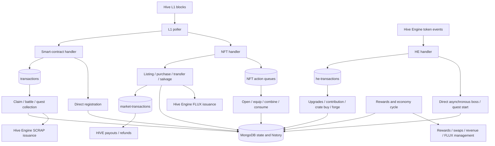
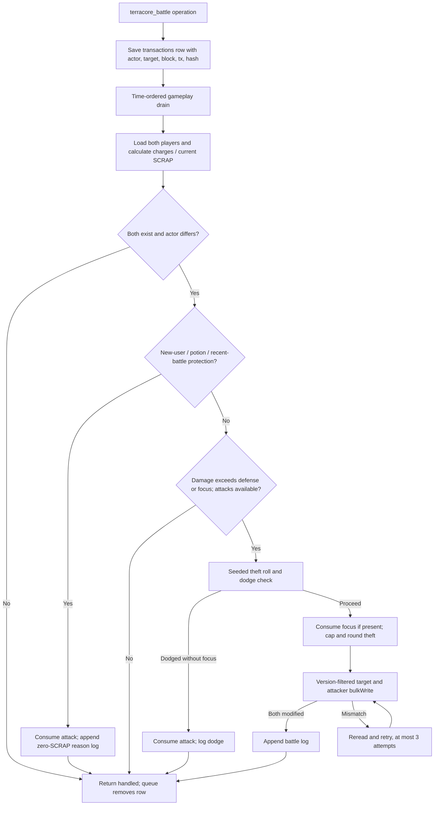

# TerraCore smart-contract implementation reference

Reviewed **2026-10-21** against [CryptoGnome/TerraCore-Smart-Contract](https://github.com/CryptoGnome/TerraCore-Smart-Contract), commit [`faf5d6b2a19f9b9f8d015ed92d3e437f8f6c1c9f`](https://github.com/CryptoGnome/TerraCore-Smart-Contract/commit/faf5d6b2a19f9b9f8d015ed92d3e437f8f6c1c9f), committed 2026-08-20.

This document describes the upstream TerraCore code at that revision. It is an external reference, not the specification for this application's Chainframe worker. Chainframe ownership, collections and recovery rules remain in [GAME_ARCHITECTURE.md](GAME_ARCHITECTURE.md) and [GAME_MECHANICS.md](GAME_MECHANICS.md).

The review traced the repository's JavaScript entry points, handlers, queue processors, domain workflows and shared helpers. No TerraCore process, maintenance script, treasury transfer or database connection was executed. Document formats below are inferred from source reads and writes; they are not exported production records. The public repository cannot establish deployed configuration, actual indexes, uptime, historical incident counts or the contents of its production database.

## Contents

1. [Execution model and source map](#1-execution-model-and-source-map)
2. [Startup, blockchain intake and scheduling](#2-startup-blockchain-intake-and-scheduling)
3. [Blockchain messages and routing](#3-blockchain-messages-and-routing)
4. [Gameplay and payment flows](#4-gameplay-and-payment-flows)
5. [Complete collection inventory](#5-complete-collection-inventory)
6. [Document formats](#6-document-formats)
7. [Ordering, retries, replay and failure behavior](#7-ordering-retries-replay-and-failure-behavior)
8. [Configuration and external dependencies](#8-configuration-and-external-dependencies)
9. [Reading a failed battle safely](#9-reading-a-failed-battle-safely)
10. [Relationship to Chainframe](#10-relationship-to-chainframe)
11. [Review and verification boundaries](#11-review-and-verification-boundaries)

## 1. Execution model and source map

TerraCore's game contract is a Node.js application that observes Hive operations and Hive Engine transactions, applies game rules, updates MongoDB, and broadcasts selected token or HIVE transfers. Hive supplies the ordered public input. Game-specific player, inventory, market and quest state is maintained off-chain in the MongoDB database named `terracore`.

The source also uses MongoDB as a durable application queue. In particular, ordinary **claims and battles both create `transactions` documents**. Financial payouts have a different queue, `market-transactions`. A battle log is a result/history record; it does not replace the queued input.



| Source area                                                                                           | Responsibility                                                                                                 |
| ----------------------------------------------------------------------------------------------------- | -------------------------------------------------------------------------------------------------------------- |
| [services/app.js][unified]                                                                            | Unified process, MongoDB connection, contexts, both chain listeners, queue startup, rewards loop and heartbeat |
| [services/smart-contract/lib/handlers.js][sc-handlers]                                                | Registration transfers and claim/battle/quest-collect Custom JSON routing                                      |
| [services/smart-contract/lib/queue.js][sc-queue]                                                      | Durable gameplay queue and drain                                                                               |
| [registration.js][registration], [claims.js][claims], [combat.js][combat], [quests.js][quest-collect] | Core registration and gameplay effects                                                                         |
| [services/hive-engine/lib/handlers.js][he-handlers], [queue.js][he-queue]                             | Token-event classification, HE replay keys and queued sink actions                                             |
| [upgrades.js][upgrades], [items.js][forge], [boss.js][boss], [quests.js][quest-start]                 | Upgrades, equipment forge, boss drops, crate purchases and quest starts                                        |
| [services/nft/lib/handlers.js][nft-handlers], [queue.js][nft-queue]                                   | NFT/market routing, payout drain and inventory action queues                                                   |
| [crates.js][crates], [items.js][nft-items], [economy.js][economy], [marketplace.js][market]           | Equipment minting, equip/salvage, relic conversion, consumables and market settlement                          |
| [services/lb-rewards/cycle.js][cycle]                                                                 | Rewards, treasury economy, quest oracle, daily board and quest expiry                                          |
| [shared/mining.js][mining], [shared/rng.js][rng]                                                      | Accrued SCRAP calculation and random-number helpers                                                            |
| [shared/error-logger.js][error-log]                                                                   | Console, Discord and MongoDB diagnostics                                                                       |

The repository retains standalone service entry points in addition to `services/app.js`. Their behavior is not identical. The unified entry point is the baseline in this document; differences are called out where they affect interpretation.

## 2. Startup, blockchain intake and scheduling

### 2.1 Unified startup

[services/app.js][unified] loads environment configuration, connects a native MongoDB client to `terracore`, initializes error reporting and shares the database/client and Hive adapters through per-service context objects. It then starts the smart-contract, NFT and HE queue loops, the L1 listener, the HE stream and the rewards loop.

It requests a partial, **non-unique** index on `hashes.trxId`, applying only to documents containing that field. The index build runs without delaying listener startup. This is a lookup optimization, not a uniqueness constraint. Other indexes cannot be inferred from the live database; this review found no other runtime `createIndex` declaration in the reviewed JavaScript.

### 2.2 L1 poller

The unified L1 poller reads `head_block_number` approximately every three seconds. On its first successful poll it initializes its local position to `head - 1`, then processes the current head. It walks forward through blocks, transactions and operations, awaiting the smart-contract handler and then the NFT handler for each operation. NFT intake also receives a block-wide incrementing operation counter, starting at zero.

This path follows **head blocks**, not an explicit last-irreversible-block boundary. Its last processed block is an in-memory variable. There is no persisted L1 checkpoint in this entry point. A process restart initializes from the new head rather than automatically replaying all unseen downtime blocks. Already-saved queue documents remain in MongoDB and are read by the queue loops.

An exception that escapes a handler prevents that block's local position from advancing. The next poll can revisit earlier operations in that block. This makes the actual deduplication limits in section 7 relevant even when handlers normally catch domain failures.

### 2.3 Hive Engine stream

The unified process selects an HE node and uses `sscjs` to stream its transactions. Each callback awaits the HE handler for each transaction in that callback. Some HE handler branches intentionally launch domain work without awaiting completion, so this does not serialize every downstream mutation. No application-owned durable HE block checkpoint is implemented in this entry point.

### 2.4 Existing loops

| Loop                | Unified behavior                                                                                                                                |
| ------------------- | ----------------------------------------------------------------------------------------------------------------------------------------------- |
| Hive L1             | Self-paced polling; schedules next poll after completion, with a 3-second delay                                                                 |
| Core gameplay queue | Reschedules about 200 ms after a completed drain                                                                                                |
| HE queue            | Reschedules about 1 second after a completed drain                                                                                              |
| NFT queues          | Payouts, crate opening, equip, combine and use run in sequence per cycle; normal delay 1 second, payout infrastructure backoff up to 60 seconds |
| Rewards/economy     | Runs cycle, then sleeps 15 minutes; outer failure waits 2 minutes                                                                               |
| Unified heartbeat   | Checks every 3 seconds; exits if L1 or HE activity is older than 30 seconds                                                                     |
| Node-list refresh   | Refreshes L1 and HE beacon lists every 30 minutes                                                                                               |

The standalone [lb-rewards/app.js][lb-app] additionally runs a quest-board watcher every 30 seconds. **The unified entry point does not start that watcher**; it generates the board through the longer rewards cycle. The standalone smart-contract entry point uses `hive.api.streamBlock` and separate activity/queue watchdogs instead of the unified L1 poller. The standalone NFT entry point contains its own routing implementation, including crate lookup differences; it should not be assumed interchangeable with the unified NFT handler.

## 3. Blockchain messages and routing

### 3.1 Hive L1 inputs

The core and NFT handlers obtain an acting user from the first Active authority in `required_auths`, or the first Posting authority in `required_posting_auths` where permitted. Listing, item transfer, salvage and relic combining explicitly require the Active-authority path. This is routing from chain operation authority fields, not an application JWT/login system.

| Operation / ID                          | Payload used                                                                          | Destination                                                               |
| --------------------------------------- | ------------------------------------------------------------------------------------- | ------------------------------------------------------------------------- |
| HIVE transfer to `terracore`            | JSON memo containing a `hash` that includes `terracore_register`; optional `referrer` | Direct registration, then registration history                            |
| `terracore_claim`                       | Actor from authorities; JSON body not used for claim amount                           | `transactions`, type `claim`, target `none`                               |
| `terracore_battle`                      | `{ "target": "defender" }`                                                            | `transactions`, type `battle`                                             |
| `terracore_quest_collect`               | `{ "quest_id": "<MongoDB ObjectId string>" }`                                         | `transactions`, type `collect`, target quest ID                           |
| HIVE transfer to `terracore.market`     | Memo action containing `tm_purchase`, item/stack type, seller and purchase details    | Direct purchase; outgoing seller/fee/refund rows queued separately        |
| `tm_create`                             | Type, item number or stack amount, price                                              | Direct listing                                                            |
| `tm_cancel`                             | Type and item/stack identity                                                          | Direct cancellation                                                       |
| `tm_transfer`                           | Type, item number, receiver                                                           | Direct transfer; the implementation uses `receiver`, despite logging `to` |
| `terracore_open_crate`                  | `{ "crate_type": "common" }`, or array                                                | `crate-transactions`                                                      |
| `terracore_equip` / `terracore_unequip` | Item number, or array of item numbers                                                 | `equip-transactions`                                                      |
| `terracore_salvage`                     | Item number                                                                           | Direct salvage and FLUX issuance                                          |
| `terracore_combine`                     | Relic `type`, such as `common_relics`                                                 | `combine-transactions`                                                    |
| `terracore_use_consumable`              | Consumable `type`, such as `attack_consumable`                                        | `use-transactions`                                                        |

These are separate TerraCore IDs, not Chainframe's single versioned `chainframe-game` envelope. Source: [core handler][sc-handlers] and [NFT handler][nft-handlers].

Illustrative battle input, before chain serialization:

```json
{
  "required_auths": [],
  "required_posting_auths": ["attacker"],
  "id": "terracore_battle",
  "json": "{\"target\":\"defender\"}"
}
```

### 3.2 Hive Engine inputs

The HE handler examines transactions from the `tokens` contract, parses their payload, checks selected execution-log error conditions and routes according to recipient, symbol and memo. The payment/burn has already happened on HE before the application grants the corresponding effect.

| Token event                  | Memo routing                                                                                             | Effect owner                                                                                    |
| ---------------------------- | -------------------------------------------------------------------------------------------------------- | ----------------------------------------------------------------------------------------------- |
| SCRAP transfer to `null`     | `terracore_engineering-...`, `terracore_damage-...`, `terracore_defense-...`, `terracore_contribute-...` | HE queue, upgrade/contribution                                                                  |
| SCRAP transfer to `null`     | `tm_buy_crate-<rarity>-...`                                                                              | HE queue, crate purchase                                                                        |
| SCRAP transfer to `null`     | `terracore_quest_start-<type>-<tier>-...`                                                                | Replay key stored, quest start launched asynchronously                                          |
| FLUX transfer to `null`      | Object memo with `hash` beginning `terracore_boss_fight` and `planet`                                    | Expected FLUX check, replay key stored, boss fight launched asynchronously                      |
| FLUX transfer to `terracore` | `terracore_forge-<item_number>-...`                                                                      | HE queue, equipment upgrade                                                                     |
| SCRAP stake                  | Payload quantity and memo                                                                                | Stake notification and hash history; this handler does not synchronize the player's stake field |

The server-observed HE transaction ID is the normal deduplication key. Some paths fall back to a memo/hash when the transaction ID is absent. The memo remains routing/audit data. Source: [HE handler][he-handlers], [HE queue][he-queue] and [hashes.js][hashes].

## 4. Gameplay and payment flows

### 4.1 Registration

1. Observe a transfer to `terracore` and parse its registration memo.
2. Read `price_feed` with `date: "global"`.
3. Compare the parsed numeric payment against the configured registration fee; an underpayment returns false.
4. Refuse registration if a `players` record already exists.
5. Insert the player's initial document.
6. Increment global and daily player counters in `stats`.
7. If the supplied referrer passes the implementation's non-self/non-`terracore`/defined checks, broadcast the configured referral amount and append `referrers` history.
8. Append `registrations` after registration returns true.

Player insertion, counters, referral broadcast and registration history are separate operations. This flow has no application transaction spanning them. The implementation parses the numeric portion of the payment; this is a description of its current check, not a claim of exact symbol/envelope verification. Source: [registration.js][registration].

### 4.2 Mining and claims

Mining is computed when a workflow needs current SCRAP, rather than by continuously crediting every player. [shared/mining.js][mining] derives effective engineering with a softcap at 333; levels above it contribute at half rate. The pre-decay per-second rate is `(effectiveEngineering + 1)^2 / 172800`. Activity decay uses `last_upgrade_time`: a 14-day grace period, then a factor of `0.9` per full week after the grace period, floored at `0.25`. Battles and claims do not reset that sink-activity timer.

Current SCRAP is the smaller of `(stored scrap + current rate × seconds since cooldown)` and `(hiveEngineStake + 1)`. This helper applies the currently calculated rate over the elapsed interval; it is not a historical segmented mining ledger.

A claim is saved in `transactions`. The claim processor reads the player, regenerates one claim per four complete hours up to five, checks availability, and atomically reserves the payout cooldown while setting stash SCRAP to zero and consuming a claim. It then broadcasts a Hive Engine `tokens.issue` for SCRAP with eight-decimal quantity and records `claims` history. A falsy broadcast result takes a restoration branch; a thrown error returns false and leaves the queue row for a later drain. These branches do not establish comprehensive irreversible payout reconciliation. Source: [claims.js][claims].

### 4.3 Battle / raid

TerraCore calls this action **battle**. Its intake `hash` is a captured `Date.now()` value, saved on the queue record. The battle seed concatenates block ID, transaction ID and that saved value using `@` separators.



Actual decisions and effects in [combat.js][combat]:

- Self-attacks and missing actor/target return handled without executing combat. There is no `isRegistered` field check in this path; normal registration creates the player, while other paths can also create partial players.
- Attack regeneration adds one per four complete hours. The normal maximum starts at eight, losing one per full five days since `last_upgrade_time`, with a minimum effective maximum of one.
- A target registered less than 24 hours ago, an active protection potion, or a target battle within 60 seconds produces a blocked result and consumes an attack. Those protection branches occur before the normal positive-charge eligibility check.
- Normal eligibility requires attacker damage greater than target defense, or a focus consumable, plus a positive current attack count.
- The theft percentage is a seeded floating draw from the attacker's crit-derived lower range toward 100%, capped at 100. Dodge uses an independent `seed + "-dodge"` stream and a 1–100 integer roll against defender dodge. Focus bypasses dodge and is consumed on the proceeding path.
- Theft is limited by the target's current stash and the attacker's available capacity, then rounded to three decimal places. Stash-full/nonpositive and NaN paths can record zero-SCRAP logs.
- Successful writes set both players' current SCRAP and mining cooldown, set battle times, consume the attack, and increment `version`. Target and attacker updates each filter on their previously read `version`.
- The implementation checks for `modifiedCount === 2` after `bulkWrite`. On mismatch it rereads and retries up to three times, recomputing stash amounts using the same saved roll. The bulk write does **not** make the two player writes atomic together.
- The success log is inserted after the player writes. Exceptions and exhausted update retries commonly still return handled, allowing the queue row to be deleted. A log's existence/absence is therefore not complete evidence of every balance effect.

The seed remains stable while that queue document survives. Intake again after deletion can capture a different wall-clock hash, and the saved queue dedup check is not a permanent processed-operation receipt.

### 4.4 Token sinks, boss fights and quests

SCRAP-funded upgrades change the base engineering/damage/defense fields, increment experience and reset `last_upgrade_time`. Their cost checks use the current base stat: engineering squared, or `(damage / 10)^2` and `(defense / 10)^2`. Contribution increases player favor/experience and global `currentFavor`. Equipment forging accepts sufficient FLUX based on salvage value and level, multiplies attributes by 1.05, raises level, writes forge history and refreshes embedded equipped-item data. Sources: [upgrades.js][upgrades] and [items.js][forge].

Boss fights require a player, permitted planet/level and a four-hour cooldown. The player cooldown/experience reservation is a guarded single-document write. A seeded Luck outcome then issues a crate/consumable or fractional relics. Planet costs/drop thresholds come from cached `planet-config` with code defaults; cache refresh interval is five minutes. Inventory issuance, counters and logs are subsequent separate writes. Source: [boss.js][boss].

Quest start validates today's board, template, player level/stats, tier-specific equipment and payment; checks the actor/date/type/tier slot lock; then inserts an `active-quests` snapshot. It records original equipped rarity/level, primary and secondary values, paid SCRAP, multiplier and completion/expiry times. The slot lock is an application read-before-insert check, not a unique index declared by this repository. Source: [HE quests.js][quest-start].

| Tier | Minimum level | Base SCRAP cost | Duration (hours) | Base draws | Completion XP |
| ---- | ------------: | --------------: | ---------------: | ---------: | ------------: |
| 1    |             1 |              20 |                1 |          2 |            25 |
| 2    |            10 |             100 |                4 |          3 |            50 |
| 3    |            25 |             235 |               12 |          4 |           100 |
| 4    |            50 |             985 |               24 |          6 |           200 |
| 5    |           100 |            4010 |               48 |         10 |           400 |

The payable cost is `ceil(base cost × quest_cost_multiplier)`, with acceptance from `floor(expected × 0.99)`. Combat/salvage/stealth/fortune/defense map to damage/engineering/dodge/luck/defense and weapon/special/armor/avatar/ship respectively. Tier 3+ requires the mapped equipped item. Upgradeable-stat thresholds are 10/50/100/200/500; item-only Luck/Dodge thresholds are 2/5/12/20/40.

Quest collection is a queued L1 action. It checks ownership, completion time and `collected`, calculates seeded rewards from the saved snapshot and loot helpers, credits relic stacks, increments XP, marks collected, writes completion history and increments daily statistics. The snapshot prevents later equipment changes from replacing quest-start inputs. Rewards still span multiple documents; there is no versioned per-effect settlement journal here. See [quest collection][quest-collect] and [quest-loot.js][quest-loot].

### 4.5 Inventory and marketplace

- Crate opening chooses a template/type/rarity/attributes from seeded inputs, checks an available unlisted crate, advances `item-count`, deletes a crate, inserts equipment and appends `nft-mints`. Supply/template rerolls are depth-bounded. These are separate writes. See [crates.js][crates] and [crate-loot.js][crate-loot].
- Equip and unequip update a player's embedded item slot and the separate equipment document. Equipment uses the upstream spelling `equiped`; player slots use `item_equipped`. See [NFT items.js][nft-items].
- Salvage broadcasts FLUX issuance, then marks the item salvaged/owner null and writes `salvage-log`. Relic combining spends 100 same-rarity relics for one crate through several writes. Consumable use deducts the inventory stack and then applies a player charge/effect/cooldown change. See [economy.js][economy].
- Listings live inside `market` objects on assets/stacks, not in a separate listings collection. The reviewed market allows equipment in `items`, relic stacks and consumable stacks. Listing creation enforces a 0.05 HIVE total-value floor; despite a source comment describing a purchase floor, the reviewed purchase function does not independently enforce that minimum. Equipment transfer/sale checks include a 24-hour transfer cooldown.
- Purchase validation and asset transfer happen directly during L1 handling. Successful purchases queue 95% seller and 5% fee payouts. Refund branches also queue outgoing transfers. Stray market transfers are refunded unless the sender is the whitelisted `terracore` account. Asset ownership, stack debits/credits, log insertion and payout enqueue are not one atomic transaction. See [marketplace.js][market] and [NFT handler][nft-handlers].
- Equipment purchases assign ownership to the observed transfer sender. The stack purchase branch instead credits `memo.buyer`, while logging/refunding against the observed sender; the reviewed function does not establish those identities are equal. That is an implementation distinction to preserve when tracing the data flow, not a validated authorization guarantee.
- `market-transactions` broadcasts transfers from `terracore.market`. It waits between rows, skips dead-lettered rows and removes rows after an awaited broadcast response. Infrastructure failures defer the batch with backoff without spending the five-attempt rejection budget; permanent failures can set `failed: true`. See section 7 for confirmation limits.

### 4.6 Rewards, treasury and quest-board cycle

The [economy cycle][cycle] selects an HE node, manages FLUX, processes SWAP.HIVE, distributes leaderboard rewards, distributes revenue, updates the quest oracle and generates/cleans up quests. Leaderboard rewards use an external leaderboard response, a pool of 0.01% of treasury SCRAP, per-player `lastRewardTime` and global `rewardtime`. Treasury routines can broadcast swaps, orders, burns and revenue transfers. This is active financial code, not a read-only analytics task.

The quest oracle samples SCRAP/FLUX HIVE prices no more often than every four hours, keeps six-sample histories and derives a multiplier clamped to 1–50. A change above 50% after warmup holds the multiplier while allowing price histories/timestamp to advance. Daily board generation uses the UTC date as its random seed, active templates and distinct type/tier pairs. Expired active quests are deleted when `expires_at` is older than current time. The template seeder reads external JSON files not included at its expected sibling `docs/quest-templates` location in the reviewed tree.

## 5. Complete collection inventory

The reviewed source references **35 distinct MongoDB collection names**, all in `terracore`. This count includes configuration/catalog collections read by the worker and support-tool references. It is not a claim that every collection is populated or that the deployment has no additional collections owned by another repository. Dynamic collection selection in marketplace workflows resolves to `items`, `relics` or `consumables` for supported paths.

| Collection             | Role / identity                                   | Main source owner                                                           |
| ---------------------- | ------------------------------------------------- | --------------------------------------------------------------------------- |
| `players`              | Player state, `username`                          | Registration, gameplay, HE, NFT, rewards                                    |
| `stats`                | Global/daily counters and economy state, `date`   | Registration, HE, quests, rewards                                           |
| `price_feed`           | Global pricing and quest oracle, `date: "global"` | Registration, HE, rewards                                                   |
| `transactions`         | Queued claim/battle/collect inputs, `_id`         | [Core queue][sc-queue]                                                      |
| `claims`               | Claim history                                     | [Claims][claims]                                                            |
| `battle_logs`          | Battle outcomes                                   | [Combat][combat]                                                            |
| `registrations`        | Registration memo confirmation history            | [Registration][registration]                                                |
| `referrers`            | Referral-transfer history                         | [Registration][registration]                                                |
| `he-transactions`      | Queued token-funded actions, `_id`/`dedupKey`     | [HE queue][he-queue]                                                        |
| `hashes`               | HE observed/processed keys and activity           | [Hashes][hashes]                                                            |
| `rejectedHashes`       | Rejected HE activity                              | [Hashes][hashes]                                                            |
| `items`                | Individual equipment, `item_number`               | [Crates][crates], [NFT items][nft-items], [forge][forge]                    |
| `item-templates`       | Equipment catalog, `id`                           | [Crates][crates], [support DB tool][nft-db]                                 |
| `item-count`           | Equipment serial counter, `supply: "total"`       | [Crates][crates]                                                            |
| `crates`               | Individual unopened crates, `item_number`         | [Boss][boss], [economy][economy], [crates][crates]                          |
| `crate-count`          | Crate serial counter, `supply: "total"`           | [Boss][boss], [economy][economy]                                            |
| `relics`               | Player/type fractional stacks and listing         | [Boss][boss], [quests][quest-collect], [economy][economy], [market][market] |
| `consumables`          | Player/type stacks and listing                    | [Boss][boss], [economy][economy], [market][market]                          |
| `planet-config`        | Boss price/drop configuration, `name`             | [Boss][boss]                                                                |
| `market-transactions`  | HIVE payout/refund queue                          | [NFT queue][nft-queue]                                                      |
| `crate-transactions`   | Queued crate openings                             | [NFT queue][nft-queue]                                                      |
| `equip-transactions`   | Queued equip/unequip                              | [NFT queue][nft-queue]                                                      |
| `combine-transactions` | Queued relic-to-crate conversion                  | [NFT queue][nft-queue]                                                      |
| `use-transactions`     | Queued consumable activation                      | [NFT queue][nft-queue]                                                      |
| `marketplace-logs`     | Listing/cancel/purchase/transfer history          | [Market][market]                                                            |
| `nft-mints`            | Equipment-mint evidence                           | [Crates][crates]                                                            |
| `nft-drops`            | Crate/relic/consumable acquisition history        | [Boss][boss], [economy][economy]                                            |
| `boss-log`             | Boss outcome history                              | [Boss][boss]                                                                |
| `forge-log`            | Equipment upgrade history                         | [Forge][forge]                                                              |
| `salvage-log`          | Equipment destruction/FLUX history                | [NFT items][nft-items]                                                      |
| `quest-templates`      | Quest catalog                                     | [Quest start][quest-start], [board generator][cycle], [seeder][quest-seed]  |
| `quest-board`          | Current daily board                               | [Cycle][cycle]                                                              |
| `active-quests`        | Player quest snapshot and collection state        | [Quest start][quest-start], [collect][quest-collect], [cleanup][cycle]      |
| `quest-log`            | Quest start/completion history                    | [Quest start][quest-start], [collect][quest-collect]                        |
| `error-log`            | Operational diagnostics                           | [Error logger][error-log]                                                   |

## 6. Document formats

### 6.1 Notation and limits

TerraCore uses the native MongoDB driver, not a central Mongoose/schema layer. There is no complete enforced database schema in the reviewed source. The following is a **source-derived data dictionary**, including initial fields and subsequent workflow additions. Older/partial records can differ.

`ObjectId` means MongoDB's generated `_id`; `ms` means a numeric Unix epoch millisecond value; `Date` means a BSON date; `N` means number; `S` string; `B` boolean; `?` marks optional/branch-specific data. `YYYY-MM-DD` means a UTC date string. ObjectId and Date examples use Extended JSON. Numeric and string amount differences are deliberate observations, not suggested normalization. Every inserted document also has an `_id`, omitted from compact field lists when uninteresting.

### 6.2 Player state: `players`

Initial shape from [registration][registration], using synthetic timestamps/names:

```json
{
  "_id": { "$oid": "000000000000000000000001" },
  "username": "player-one",
  "favor": 0,
  "scrap": 1,
  "health": 10,
  "damage": 10,
  "defense": 10,
  "engineering": 1,
  "cooldown": 1792533600000,
  "minerate": 0.0001,
  "attacks": 3,
  "lastregen": 1792533600000,
  "claims": 3,
  "lastclaim": 1792533600000,
  "registrationTime": 1792533600000,
  "lastBattle": 1792533600000,
  "stats": {
    "damage": 10,
    "defense": 10,
    "engineering": 1,
    "dodge": 0,
    "crit": 0,
    "luck": 0
  },
  "consumables": { "protection": 0, "protection_times": [], "focus": 0 },
  "hiveEngineStake": 0,
  "items": {}
}
```

| Field group                                                                | Format and behavior                                                                                                             |
| -------------------------------------------------------------------------- | ------------------------------------------------------------------------------------------------------------------------------- |
| `username`                                                                 | S; normal player lookup identity                                                                                                |
| `scrap`, `favor`, `health`, `damage`, `defense`, `engineering`, `minerate` | N; stored resources/base values; current mining helper uses `stats.engineering`, not simply stored `minerate`                   |
| `stats`                                                                    | Object with numeric damage/defense/engineering/dodge/crit/luck; battle reads these totals; upgrades update separate base fields |
| `hiveEngineStake`                                                          | N; stash capacity is this plus one; read by workflows, not maintained by the reviewed stake handler                             |
| `attacks`, `claims`                                                        | N; stored charges, regenerated by workflows                                                                                     |
| `cooldown`, `lastregen`, `lastclaim`, `registrationTime`, `lastBattle`     | ms; mining/charge/protection inputs                                                                                             |
| `version?`                                                                 | N; incremented by many writes; registration does not initialize it, so not every document starts with a numeric version         |
| `lastPayout?`, `last_upgrade_time?`, `lastRewardTime?`                     | ms; claim reservation, sink-activity decay, rewards marker                                                                      |
| `experience?`, `level?`                                                    | N; experience added by sinks/bosses/quests; level read for eligibility; registration does not initialize these fields           |
| `boss_data?`                                                               | Array of planet entries read with `name`, `level`, `lastBattle?`; initialization is not shown in registration                   |
| `consumables.<effect>?`                                                    | Numeric activation counts; protection/focus initially present; other effects added on use                                       |
| `consumables.<effect>_times?`                                              | Array of ms activation timestamps for timed effects                                                                             |
| `items.<slot>?`                                                            | Embedded equipped item, described below                                                                                         |

An equipped slot contains `{ item_number: N, item_id: N, item_equipped: true, rarity: S, level: N, attributes: { damage, defense, engineering, dodge, crit, luck } }`. Empty slots have null IDs, `item_equipped: false` and zero attributes. Slot names include avatar, armor, weapon, special and ship.

The code reads some derived/API-maintained fields whose complete initialization lives outside the reviewed registration path. Do not infer a full external API schema from these reads. There is no Chainframe-style `isRegistered`, active raid marker or settlement journal in this initial player format.

### 6.3 Global state: `stats`, `price_feed`, `planet-config`

| Collection      | Source-derived fields                                                                                                                                                                                                                                                                                                                                                               |
| --------------- | ----------------------------------------------------------------------------------------------------------------------------------------------------------------------------------------------------------------------------------------------------------------------------------------------------------------------------------------------------------------------------------- |
| `stats`         | `date: "global"` or UTC date; numeric `players`, `currentFavor`, `terracoreScrap`, `flux_burned_forge`, `quests_started`, `scrap_burned_quests`, `quests_collected`, dynamic `crates_purchased_<rarity>`; global `rewardtime: ms`. Different global/daily documents carry different subsets.                                                                                        |
| `price_feed`    | `date: "global"`; `registration_fee: S` such as an amount with symbol, `referral_fee: S` passed to native transfer; `price: N` common crate SCRAP price, `scrap_usd: N`; optional uncommon/rare/epic `*_crate_usd: N`; `quest_cost_multiplier`, `quest_target_price`, `quest_flux_target`: N; `scrap_price_history`, `flux_price_history`: N arrays; `quest_oracle_updated_at: ms`. |
| `planet-config` | `name: S`, `flux: N`, `rarityThresholds: N[]`, `rarityValues: S[]`, `dropThresholds: N[]`, `dropValues: S[]`. Threshold/value arrays are interpreted in matching positions.                                                                                                                                                                                                         |

For example, a supported boss config can have `name: "Terracore"`, `flux: 1`, rarity thresholds `[950, 985, 995, 1000]` mapped to `["uncommon", "rare", "epic", "legendary"]`, and drop thresholds `[900, 1000]` mapped to `["consumable", "crate"]`. Those values mirror the code fallback; actual database overrides are unknown. Pricing data is required by several workflows and is partly maintained by external code; missing documents are not automatically constructed into a complete configuration. Sources: [registration][registration], [boss][boss], [forge][forge], [quest start][quest-start], [cycle][cycle].

### 6.4 Core gameplay queue: `transactions`

```json
{
  "_id": { "$oid": "000000000000000000000002" },
  "username": "attacker",
  "type": "battle",
  "target": "defender",
  "blockId": "<Hive block ID>",
  "trxId": "<Hive transaction ID>",
  "hash": 1792533600000,
  "time": 1792533600000
}
```

`type` is `claim`, `battle` or `collect`. `target` is `none`, a target username or a quest ObjectId string respectively. `hash` is supplied for battles; claim/collect callers do not supply it. `time` is numeric ms and drives ascending drain order. The enqueue duplicate lookup uses `(blockId, trxId, username, target)` when chain IDs exist; it does not include operation index or type. No status, attempt counter, durable terminal receipt or per-step write evidence is added by this queue. Source: [core queue][sc-queue].

### 6.5 Core histories: `claims`, `battle_logs`, `registrations`, `referrers`

| Collection      | Format                                                                                                                                                                                                           |
| --------------- | ---------------------------------------------------------------------------------------------------------------------------------------------------------------------------------------------------------------- |
| `claims`        | `{ username: S, qty: S or N, status: "success" / "rejected" / "failed", time: ms }`; successful quantity originates from `toFixed(8)`, zero failures/rejections can be numeric.                                  |
| `battle_logs`   | `{ username: S, attacked: S, scrap: N, seed?: S, roll?: N, dodged?: B, reason?: S, timestamp: ms }`. Successful logs need not contain `dodged`/`reason`; blocked/error paths omit seed/roll in several branches. |
| `registrations` | `{ hash: S, username: S, time: ms }`; hash is the memo's split suffix.                                                                                                                                           |
| `referrers`     | `{ referrer: S, username: S, amount: S, time: ms }`; amount is the native transfer string.                                                                                                                       |

Battle reasons written by the reviewed code include `new_user_protection`, `protection_potion`, `cooldown`, `dodge`, `error` and `stash_full`. `username` is attacker; `attacked` is defender. These histories do not use a universal operation-key receipt format. Sources: [claims][claims], [combat][combat], [registration][registration].

### 6.6 HE queue and replay records

```json
{
  "_id": { "$oid": "000000000000000000000003" },
  "username": "player-one",
  "quantity": "100",
  "type": "engineering",
  "hash": "terracore_engineering-example",
  "dedupKey": "<HE transaction ID>",
  "time": { "$date": "2026-10-20T22:00:00.000Z" }
}
```

| Collection        | Format and use                                                                                                                                                                                                                    |
| ----------------- | --------------------------------------------------------------------------------------------------------------------------------------------------------------------------------------------------------------------------------- |
| `he-transactions` | Above shape; type engineering/defense/damage/contribute/buy_crate/forge. Quantity comes from HE payload; `time` is BSON Date, unlike the core queue. `hash` retains memo routing and `dedupKey` normally holds HE transaction ID. |
| `hashes`          | `{ hash: memo, username: S, amount: N, time: ms, trxId?: S }`; `hash` can be a string or object depending on the observed memo; amount is parsed numeric. Legacy records may lack `trxId`.                                        |
| `rejectedHashes`  | `{ hash: memo, username: S, time: ms }`; no universal reason/error-code field is inserted here.                                                                                                                                   |

Boss/quest-start keys can be inserted before the asynchronous domain action completes; therefore a `hashes` row can mean an observed/reserved event, not proof that every reward or inventory write finished. Other queued types store their key after a truthy domain result. Sources: [HE handler][he-handlers], [queue][he-queue], [hashes][hashes].

### 6.7 Equipment: `item-templates`, `items`, `item-count`

`item-templates` is read by numeric template `id`. Catalog JSON contains `name`, `id`, nullable instance fields, `edition`, `max_supply`, `description`, `image`, `owner`, `type`, `rarity`, `attributes` and `market`. The [sample weapon template][template] still includes historical `attributes.attack` and `stash`; minted attributes come from the current crate-loot generator. Template files are not proof of the exact production catalog after external edits/tools.

Illustrative equipment instance, using symbolic content rather than a production export:

```json
{
  "_id": { "$oid": "000000000000000000000004" },
  "name": "Example weapon",
  "id": 2000,
  "edition": "Beta",
  "print": 1,
  "max_supply": 10000,
  "description": "<catalog description>",
  "image": "<catalog image URL>",
  "owner": "player-one",
  "type": "weapon",
  "rarity": "common",
  "equiped": false,
  "burnt": false,
  "attributes": {
    "damage": 1,
    "defense": 0,
    "engineering": 0,
    "dodge": 0,
    "crit": 0,
    "luck": 0
  },
  "market": {
    "listed": false,
    "price": 0,
    "seller": null,
    "created": 0,
    "expires": 0,
    "sold": 0
  },
  "item_number": 1
}
```

Subsequent writes can add `level: N`, `version: N`, `lastTransfer: ms` and `salvaged: B`, change `owner` to null on salvage, and replace `market` with a smaller object. `burnt` and `salvaged` are distinct field names in source. Equipment identities are `item_number` (instance serial), `id` (template), and `print` (template print count); they are not interchangeable.

`item-count` has `{ supply: "total", count: N }`. Minting reads/updates this serial counter separately from crate deletion and instance insertion. Source: [crates][crates], [NFT items][nft-items], [forge][forge], [market][market].

### 6.8 Crates, stacks and listing objects

| Collection    | Format                                                                                       |
| ------------- | -------------------------------------------------------------------------------------------- |
| `crates`      | `{ name: S, rarity: S, owner: S, item_number: N, image: S, equiped: false, market: Market }` |
| `crate-count` | `{ supply: "total", count: N }`                                                              |
| `relics`      | `{ username: S, version?: N, type: "<rarity>_relics", amount: N, market?: StackMarket }`     |
| `consumables` | `{ username: S, version?: N, type: "<effect>_consumable", amount: N, market?: StackMarket }` |

`Market` starts as `{ listed: B, price: N or S, seller: S or null, created: ms or 0, expires: ms or 0, sold: ms or 0 }`. A stack adds `amount: N` for the listed subset. Initial price is numeric zero; listing price is supplied by the protocol and purchase code can expect an amount string. Post-sale/salvage objects can omit some initial fields. Stack purchases may upsert a buyer record containing only username/type/amount, so `version` and `market` are not universally present.

Relic balances can be fractional. Consumable stacks are separate inventory from player `consumables`, which represents activated effects. Crates are individual documents, not a wallet/rarity quantity stack. Sources: [boss][boss], [economy][economy], [market][market].

### 6.9 NFT action and payout queues

| Collection             | Inserted document fields, excluding `_id`                                                                                                 |
| ---------------------- | ----------------------------------------------------------------------------------------------------------------------------------------- |
| `market-transactions`  | `username: S`, `amount: S` such as `"1.000 HIVE"`, `type: S` containing transfer memo text, `time: ms`                                    |
| `crate-transactions`   | `username: S`, `rarity: S`, `blockId: S`, `trxId: S`, `hash: N`, `time: ms`; unified intake supplies block-wide operation counter as hash |
| `equip-transactions`   | `username: S`, `item: input item number`, `type: "equip" / "unequip"`, `time: ms`                                                         |
| `combine-transactions` | `username: S`, `type: S` relic type, `time: ms`                                                                                           |
| `use-transactions`     | `username: S`, `type: S` consumable type, `time: ms`                                                                                      |

Payout retries can add `attempts: N`, `lastError: S` and `failed: true`. `type` on a payout is a human-readable memo, not an action enum. Dead-letter rows remain stored and are excluded by `{ failed: { $ne: true } }`. Inventory action queues have no equivalent persisted attempt/status journal in this source. Their drains ordinarily call the workflow then delete the row. Source: [NFT queue][nft-queue].

### 6.10 Inventory, marketplace and boss history

| Collection         | Inserted format                                                                                                                                                                                                                                                                          |
| ------------------ | ---------------------------------------------------------------------------------------------------------------------------------------------------------------------------------------------------------------------------------------------------------------------------------------- |
| `marketplace-logs` | `{ action: "create" / "cancel" / "purchase" / "transfer", id: N or S, item_number: N or S, buyer: S or null, seller: S, price: S or N or null, marketplace: input or null, rarity: S, qty: N, created: ms }`. Stack identities use type strings; equipment uses template/serial numbers. |
| `nft-mints`        | `{ item_id: N, item_number: N, rarity: S, owner: S, type: S, attributes: object, edition: S, seed: S, roll: N, timestamp: ms }`                                                                                                                                                          |
| `nft-drops`        | `{ name: S, rarity: S, owner: S, item_number: N or null, purchased: B, time: Date, amount?: N, cost?: N, relic?: B }`. Different drop/purchase paths populate different optional fields.                                                                                                 |
| `boss-log`         | `{ username: S, planet: S, result: B, roll: N, luck: N, rarity?: S, drop: S, amount?: N, time: ms }`. A successful Luck roll can yield crate/consumable; a miss can still award relics.                                                                                                  |
| `forge-log`        | `{ username: S, item: object, flux: input quantity, time: Date }`; `item` is the equipment snapshot held before the attribute upgrade.                                                                                                                                                   |
| `salvage-log`      | `{ username: S, item_number: N, value: N, time: ms }`; value is the FLUX salvage reward.                                                                                                                                                                                                 |

Cancellation logs can contain cleared listing price/quantity because logging occurs after resetting the listing object. A consumer should use recorded fields rather than infer original sale intent. Sources: [market][market], [crates][crates], [boss][boss], [economy][economy], [forge][forge], [NFT items][nft-items].

### 6.11 Quest catalog and board

`quest-templates` fields used by runtime are `_id: ObjectId`, `name: S`, `active: B`, `quest_type: S`, `tier: N`, optional `flavor: S`, `image_url: S` and `legendary: B`. The generic seeder stores all fields from input JSON, so this is the known runtime subset, not a strict complete validator.

`quest-board` is a current-board document replaced through an empty filter:

```json
{
  "_id": { "$oid": "000000000000000000000005" },
  "date": "2026-10-20",
  "slots": [
    {
      "template_id": { "$oid": "000000000000000000000006" },
      "quest_type": "combat",
      "tier": 1,
      "name": "Example mission",
      "flavor": "<template flavor>",
      "image_url": "<template image URL>",
      "duration_hours": 1,
      "base_rolls": 2
    }
  ],
  "generated_at": 1792533600000
}
```

The example shortens the slot array. The generator attempts five type slots plus a bonus sixth, subject to available templates. No unique singleton constraint is declared here. Sources: [board generator][cycle] and [template seeder][quest-seed].

### 6.12 `active-quests`

| Field                                                                                 | Type / meaning                                     |
| ------------------------------------------------------------------------------------- | -------------------------------------------------- |
| `_id`, `template_id`                                                                  | ObjectId; instance identity and catalog reference  |
| `username`, `board_date`, `quest_type`, `name`, `image_url`                           | S; actor, original board and presentation snapshot |
| `tier`                                                                                | N                                                  |
| `primary_stat`, `required_item_type`                                                  | S                                                  |
| `secondary_stat`, `equipped_item_rarity`                                              | S or null                                          |
| `equipped_item_level`, `item_attribute_value`, `effective_primary_stat`, `base_rolls` | N; saved eligibility/reward inputs                 |
| `secondary_stat_value`                                                                | N or null                                          |
| `scrap_paid`, `multiplier_applied`                                                    | N; captured payment/pricing inputs                 |
| `started_at`, `completes_at`, `expires_at`                                            | ms; expiry is completion plus 30 days              |
| `collected`                                                                           | B, initially false                                 |
| `collected_at?`                                                                       | ms, written after rewards/XP                       |

The original start record remains as a date/type/tier slot lock even after collection until expiry cleanup. The collect workflow checks completion but does not itself enforce `expires_at`; cleanup removes expired records. Sources: [quest start][quest-start], [collect][quest-collect], [cleanup][cycle].

### 6.13 `quest-log`

Common fields are `username: S`, `action: "start" / "complete"`, `quest_type: S`, `tier: N`, `name: S`, `board_date: S`, `time: Date`.

- Start adds `started_at: ms`, `completes_at: ms`, `scrap_paid: N`.
- Complete adds `base_roll: N`, `effective_roll: N`, `draw_count: N`, `rewards: { common: N, uncommon: N, rare: N, epic: N, legendary: N }`, `xp: N`, `seed: S`.

These logs do not persist the active quest `_id` as a dedicated field in the reviewed insertions. Correlation cannot be assumed from name alone. Sources: [quest start][quest-start] and [collect][quest-collect].

### 6.14 `error-log`

The central logger inserts `{ code: S, severity: S, description: S, service: S, fn: S, username?: S, blockId?: S, message: S, stack?: S, extra?: object, timestamp: Date }`. Services are derived from SYS/SC/HE/NFT/LB code prefixes unless supplied. Database logging is best-effort and errors are swallowed. ERROR/FATAL diagnostics also attempt Discord delivery; console output can include stack traces. This format belongs to TerraCore and is different from Chainframe's private diagnostic filtering. Sources: [error logger][error-log] and [error code catalog][error-codes].

## 7. Ordering, retries, replay and failure behavior

### 7.1 What the blockchain queue does and does not provide

Hive records signed inputs and their chain order. The application still needs to know whether its off-chain effects were applied. TerraCore explicitly bridges those responsibilities with persistent queue rows and selected hash/cooldown/version checks. Chain input alone does not atomically commit two MongoDB players, a history row and an outgoing transfer.

| Path                | Existing protection                                                      | Limit visible in source                                                                                              |
| ------------------- | ------------------------------------------------------------------------ | -------------------------------------------------------------------------------------------------------------------- |
| Core enqueue        | Checks existing queue row using chain IDs/actor/target                   | Read-then-insert; no declared unique index; lookup only covers surviving queue rows; operation index not included    |
| Battle settlement   | Version-filtered player writes, up to 3 retries, log after writes        | Two-document bulk write can partially apply; no per-step effect journal; many failure returns are treated as handled |
| Claim               | Guarded single-player payout reservation                                 | Broadcast/DB acknowledgment gaps and thrown errors lack exact durable transfer reconciliation                        |
| HE enqueue          | Checks queue `dedupKey` and `hashes.trxId`                               | Read-then-insert; lookup index is non-unique; fallback memo identities have weaker provenance                        |
| HE boss/quest start | Hash stored before launching action; boss cooldown guarded               | A saved hash need not mean fulfillment completed; asynchronous actions can overlap other workflows                   |
| NFT equipment sale  | Guard on listed/owner when transferring equipment                        | Ownership transfer and payout/log enqueue are separate; stack transfers have separate debit/credit writes            |
| Payout queue        | Awaited broadcast, pacing, infrastructure backoff, 5-attempt dead-letter | No persisted immutable signed intent or irreversible/canonical reread protocol in this queue                         |
| Quest collection    | Collected flag and original snapshot                                     | Relic awards/XP precede collected flag; partial failures are not recorded with atomic reward markers                 |
| Leaderboard payout  | Per-player reward-time marker                                            | Broadcast and marker are separate; helper catches broadcast failures, so marker is not proof of irreversible payment |

### 7.2 Why a failed battle often does not stop everyone

The core queue handles a snapshot of rows in `time` order. Claim/battle rows are deleted when the domain function returns truthy; false leaves them saved while the loop can visit later rows. Battle returns true for normal invalid/protected outcomes and for many errors, including caught bulk-write failures. The queue also catches many ordinary failures and schedules another drain. It does not implement Chainframe's old `reconciliation` checkpoint stop.

That behavior improves apparent continuation, but **does not prove nothing changed** before an error. Partial player writes, consumed focus or missing history remain possible from the write order. Deleting a row after a handled error is a policy in this upstream code, not evidence that safely deleting an uncertain Chainframe raid is equivalent.

Quest-collect queue rows are deleted after the call without consulting its boolean return. HE queue branches likewise generally delete after invocation, even when a result is false; a truthy result controls hash recording. NFT inventory drains generally delete after their awaited workflow call. These details matter when investigating missing effects.

### 7.3 Broadcast uncertainty

The NFT payout code treats a matching duplicate-transaction error pattern as already sent and removes the queue row. It describes an awaited broadcast response as confirmation. At this layer there is no subsequent irreversible execution check, archived signed intent, or persisted broadcast ID used to resolve an ambiguous timeout. A later rebuilt broadcast is not proven identical solely because a previous request may have timed out. Documenting the existing heuristic does not establish broadcast-once guarantees.

### 7.4 Restart and deployment assumptions

The unified process exits when its stream heartbeat is stale and expects external process management to restart it. Package scripts reference PM2 and `ecosystem.config.js`, but that configuration file is absent from the reviewed Git tree. Therefore exact deployed process count, restart policy and chosen entry point cannot be verified from this repository revision. The package `main` points at the standalone smart-contract app; `services/app.js` also announces a unified process. Do not resolve this ambiguity by assuming a particular production topology.

No shared MongoDB transaction/session, worker lease, versioned raid journal, account quarantine/dependency barrier or universal processed-receipt collection was found in these reviewed paths. There are local atomic guards, but they do not make an entire multi-document workflow atomic. Helpers named `clearTransactions` or support scripts containing destructive resets are not automatic recovery specifications and were not executed.

## 8. Configuration and external dependencies

The [package manifest][package] declares native `mongodb`, `@hiveio/hive-js`, `sscjs`, `seedrandom`, dotenv, Discord webhooks and supporting libraries. This differs from Chainframe's SDK/repository architecture.

| Configuration / dependency                                                       | Purpose                                                                                   |
| -------------------------------------------------------------------------------- | ----------------------------------------------------------------------------------------- |
| `MONGO_URL`                                                                      | MongoDB connection; application selects `terracore` database                              |
| `ACTIVE_KEY`                                                                     | Core treasury/HE and rewards broadcasts                                                   |
| `NFT_ACTIVE_KEY`                                                                 | NFT market-account transfer path                                                          |
| `ACTIVE_KEY2`                                                                    | NFT FLUX issuance path                                                                    |
| `SC_DISCORD_WEBHOOK`, `_2`, `_3`                                                 | Core registration/gameplay/quest notifications                                            |
| `NFT_DISCORD_WEBHOOK`, `NFT_DISCORD_WEBHOOK2`, `3`, `4`                          | NFT/market notifications                                                                  |
| `HE_DISCORD_WEBHOOK`, `HE_MARKET_WEBHOOK`, `HE_BOSS_WEBHOOK`, `HE_FORGE_WEBHOOK` | HE activity notifications                                                                 |
| `ERROR_DISCORD_WEBHOOK`                                                          | Central operational alerts                                                                |
| L1 and HE node helpers                                                           | Beacon list refresh, node selection and health tracking                                   |
| TerraCore external API                                                           | Leaderboard, and source-commented pricing/derived-state ownership outside this repository |
| Hive Engine contracts                                                            | Token issuance/transfers/burns, market orders and liquidity-pool swaps                    |
| Keychain swap service                                                            | Treasury conversion routes in the rewards cycle                                           |

Only environment variable names are documented. Secrets and production values are neither needed nor included. Account names in the source are routing identities, not a request to use these accounts from Chainframe. Source: [unified startup][unified], [cycle][cycle], [L1 node helper][l1-node] and [HE node helper][he-node].

## 9. Reading a failed battle safely

A read-only investigation should correlate the original L1 operation, any surviving `transactions` row, both player records, relevant `battle_logs`, and `error-log` entries around the event. Preserve original documents and timestamps. Distinguish the initial failure from subsequent retries or restarts.

Questions the evidence can answer include:

1. Was the action actually enqueued, and did it retain block ID, transaction ID and the battle hash?
2. Did both players exist with the nested fields the battle reads, especially `stats` and `consumables`?
3. Did protection, cooldown, dodge or capacity return an ordinary handled result?
4. Did a version-filtered bulk write modify zero, one or both players before a failure?
5. Did a retry reread a partially changed state, and was the result log written?
6. Did the queue delete the row, retain it, or fail during deletion?
7. Did the process restart at a new head and leave unseen downtime input unprocessed?

The source has a concrete partial-profile hazard: registration creates complete players, but consumable activation uses player upserts in several branches, and stack purchases can create sparse inventory records. A partial player missing `consumables` can throw on property access in battle. This is a code-level possibility, **not a proven explanation of either the user's earlier Chainframe raid or a TerraCore production incident**. TerraCore's missing-player case itself returns handled before accessing nested fields.

Current balances alone cannot establish a historical debit/credit pair. A success log is written after balance updates, but a missing log does not prove no write occurred. A surviving queue row does not prove effects were never attempted. The reviewed implementation has no complete automatic evidence format that resolves every such ambiguity.

## 10. Relationship to Chainframe

| Topic                         | TerraCore at the reviewed commit                         | Chainframe ownership/reference                                                 |
| ----------------------------- | -------------------------------------------------------- | ------------------------------------------------------------------------------ |
| Chain input                   | Separate TerraCore Custom JSON IDs and HE memo routes    | Shared version-1 `chainframe-game` protocol                                    |
| Database                      | `terracore`; 35 referenced collection names              | Existing configured database and seven collection repositories                 |
| Ordinary gameplay persistence | `transactions` queue for claims/battles/quest collection | Existing pending/processed operation lifecycle                                 |
| Failure continuation          | Many battle failures return handled and row is deleted   | Durable raid quarantine allows unrelated work while affected dependencies wait |
| Interrupted raid evidence     | Player versions and logs; no per-step raid journal       | Version-1 raid settlement plan and atomic player-step markers                  |
| Financial recovery            | Dedicated payout queue and local guards                  | Exact financial reservation/intent/reconciliation evidence                     |
| Confirmation                  | Source histories, broadcasts and external API consumers  | Existing personal-history poller owns authoritative UI confirmation            |
| Startup position              | Unified in-memory head-block cursor                      | Worker lease/readiness and latest-irreversible startup rules                   |

This comparison explains architectural differences; it does not authorize importing TerraCore code or replacing Chainframe's recovery, signing, finality, formulas or database contracts. See [Chainframe architecture](GAME_ARCHITECTURE.md) for implemented ownership and deployment gates.

## 11. Review and verification boundaries

This is a static source review, pinned to the commit above. The collection inventory was checked across the fetched JavaScript files, including literal collection calls and marketplace dynamic selectors. Field formats were traced from registration/queue/history insertions and subsequent workflow updates. Catalog and quest fields maintained outside the public runtime were identified as partial contracts.

Mermaid diagrams describe actual source ownership and write order, not transactional guarantees. Examples use synthetic identities and data. No live raid, payment, collection inspection, replay, seeding or support-tool execution was performed. Upstream `package.json` declares a placeholder failing `test` script; static review does not establish runtime test coverage or production correctness. When reviewing a newer version, update the commit pin and recheck entry points, collection calls, atomic guards, broadcast acknowledgment handling and external API assumptions together.

[unified]: https://github.com/CryptoGnome/TerraCore-Smart-Contract/blob/faf5d6b2a19f9b9f8d015ed92d3e437f8f6c1c9f/services/app.js
[sc-handlers]: https://github.com/CryptoGnome/TerraCore-Smart-Contract/blob/faf5d6b2a19f9b9f8d015ed92d3e437f8f6c1c9f/services/smart-contract/lib/handlers.js
[sc-queue]: https://github.com/CryptoGnome/TerraCore-Smart-Contract/blob/faf5d6b2a19f9b9f8d015ed92d3e437f8f6c1c9f/services/smart-contract/lib/queue.js
[registration]: https://github.com/CryptoGnome/TerraCore-Smart-Contract/blob/faf5d6b2a19f9b9f8d015ed92d3e437f8f6c1c9f/services/smart-contract/lib/registration.js
[claims]: https://github.com/CryptoGnome/TerraCore-Smart-Contract/blob/faf5d6b2a19f9b9f8d015ed92d3e437f8f6c1c9f/services/smart-contract/lib/claims.js
[combat]: https://github.com/CryptoGnome/TerraCore-Smart-Contract/blob/faf5d6b2a19f9b9f8d015ed92d3e437f8f6c1c9f/services/smart-contract/lib/combat.js
[quest-collect]: https://github.com/CryptoGnome/TerraCore-Smart-Contract/blob/faf5d6b2a19f9b9f8d015ed92d3e437f8f6c1c9f/services/smart-contract/lib/quests.js
[quest-loot]: https://github.com/CryptoGnome/TerraCore-Smart-Contract/blob/faf5d6b2a19f9b9f8d015ed92d3e437f8f6c1c9f/services/smart-contract/lib/quest-loot.js
[he-handlers]: https://github.com/CryptoGnome/TerraCore-Smart-Contract/blob/faf5d6b2a19f9b9f8d015ed92d3e437f8f6c1c9f/services/hive-engine/lib/handlers.js
[he-queue]: https://github.com/CryptoGnome/TerraCore-Smart-Contract/blob/faf5d6b2a19f9b9f8d015ed92d3e437f8f6c1c9f/services/hive-engine/lib/queue.js
[hashes]: https://github.com/CryptoGnome/TerraCore-Smart-Contract/blob/faf5d6b2a19f9b9f8d015ed92d3e437f8f6c1c9f/services/hive-engine/lib/hashes.js
[upgrades]: https://github.com/CryptoGnome/TerraCore-Smart-Contract/blob/faf5d6b2a19f9b9f8d015ed92d3e437f8f6c1c9f/services/hive-engine/lib/upgrades.js
[forge]: https://github.com/CryptoGnome/TerraCore-Smart-Contract/blob/faf5d6b2a19f9b9f8d015ed92d3e437f8f6c1c9f/services/hive-engine/lib/items.js
[boss]: https://github.com/CryptoGnome/TerraCore-Smart-Contract/blob/faf5d6b2a19f9b9f8d015ed92d3e437f8f6c1c9f/services/hive-engine/lib/boss.js
[quest-start]: https://github.com/CryptoGnome/TerraCore-Smart-Contract/blob/faf5d6b2a19f9b9f8d015ed92d3e437f8f6c1c9f/services/hive-engine/lib/quests.js
[nft-handlers]: https://github.com/CryptoGnome/TerraCore-Smart-Contract/blob/faf5d6b2a19f9b9f8d015ed92d3e437f8f6c1c9f/services/nft/lib/handlers.js
[nft-queue]: https://github.com/CryptoGnome/TerraCore-Smart-Contract/blob/faf5d6b2a19f9b9f8d015ed92d3e437f8f6c1c9f/services/nft/lib/queue.js
[crates]: https://github.com/CryptoGnome/TerraCore-Smart-Contract/blob/faf5d6b2a19f9b9f8d015ed92d3e437f8f6c1c9f/services/nft/lib/crates.js
[crate-loot]: https://github.com/CryptoGnome/TerraCore-Smart-Contract/blob/faf5d6b2a19f9b9f8d015ed92d3e437f8f6c1c9f/services/nft/lib/crate-loot.js
[nft-items]: https://github.com/CryptoGnome/TerraCore-Smart-Contract/blob/faf5d6b2a19f9b9f8d015ed92d3e437f8f6c1c9f/services/nft/lib/items.js
[economy]: https://github.com/CryptoGnome/TerraCore-Smart-Contract/blob/faf5d6b2a19f9b9f8d015ed92d3e437f8f6c1c9f/services/nft/lib/economy.js
[market]: https://github.com/CryptoGnome/TerraCore-Smart-Contract/blob/faf5d6b2a19f9b9f8d015ed92d3e437f8f6c1c9f/services/nft/lib/marketplace.js
[cycle]: https://github.com/CryptoGnome/TerraCore-Smart-Contract/blob/faf5d6b2a19f9b9f8d015ed92d3e437f8f6c1c9f/services/lb-rewards/cycle.js
[lb-app]: https://github.com/CryptoGnome/TerraCore-Smart-Contract/blob/faf5d6b2a19f9b9f8d015ed92d3e437f8f6c1c9f/services/lb-rewards/app.js
[mining]: https://github.com/CryptoGnome/TerraCore-Smart-Contract/blob/faf5d6b2a19f9b9f8d015ed92d3e437f8f6c1c9f/shared/mining.js
[rng]: https://github.com/CryptoGnome/TerraCore-Smart-Contract/blob/faf5d6b2a19f9b9f8d015ed92d3e437f8f6c1c9f/shared/rng.js
[error-log]: https://github.com/CryptoGnome/TerraCore-Smart-Contract/blob/faf5d6b2a19f9b9f8d015ed92d3e437f8f6c1c9f/shared/error-logger.js
[error-codes]: https://github.com/CryptoGnome/TerraCore-Smart-Contract/blob/faf5d6b2a19f9b9f8d015ed92d3e437f8f6c1c9f/shared/error-codes.js
[l1-node]: https://github.com/CryptoGnome/TerraCore-Smart-Contract/blob/faf5d6b2a19f9b9f8d015ed92d3e437f8f6c1c9f/shared/l1-node.js
[he-node]: https://github.com/CryptoGnome/TerraCore-Smart-Contract/blob/faf5d6b2a19f9b9f8d015ed92d3e437f8f6c1c9f/shared/he-node.js
[package]: https://github.com/CryptoGnome/TerraCore-Smart-Contract/blob/faf5d6b2a19f9b9f8d015ed92d3e437f8f6c1c9f/package.json
[template]: https://github.com/CryptoGnome/TerraCore-Smart-Contract/blob/faf5d6b2a19f9b9f8d015ed92d3e437f8f6c1c9f/services/nft/data/weapon/2000.json
[quest-seed]: https://github.com/CryptoGnome/TerraCore-Smart-Contract/blob/faf5d6b2a19f9b9f8d015ed92d3e437f8f6c1c9f/scripts/seed-quest-templates.js
[nft-db]: https://github.com/CryptoGnome/TerraCore-Smart-Contract/blob/faf5d6b2a19f9b9f8d015ed92d3e437f8f6c1c9f/services/nft/db.js
